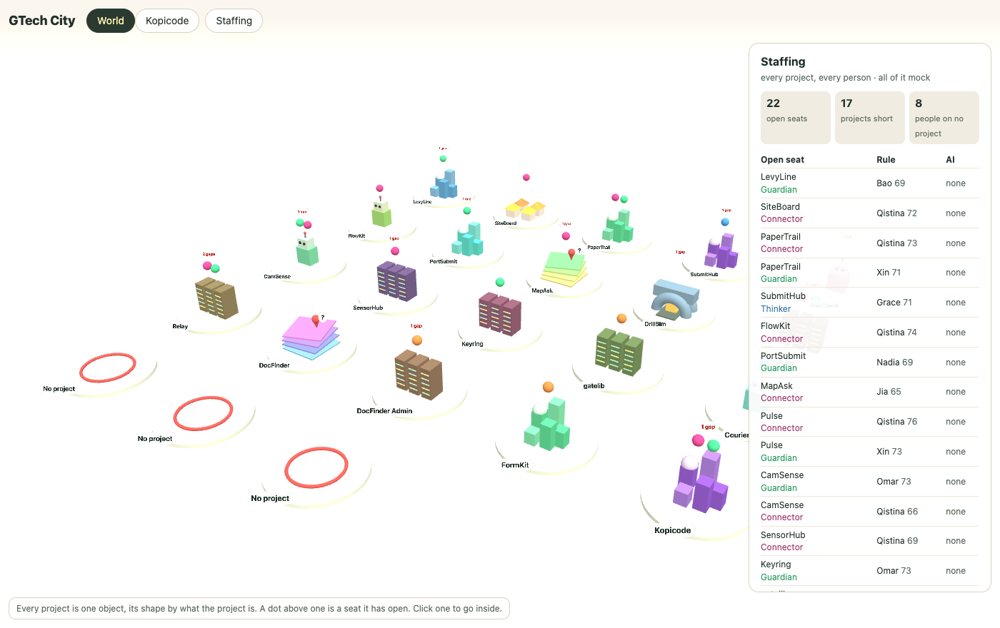
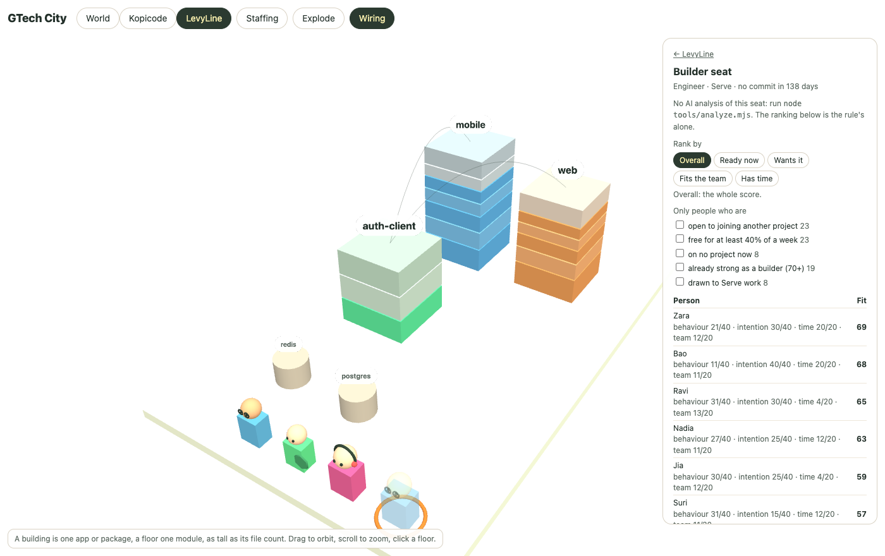

# GTech City

Every GTech project as a place in one 3D city, so that someone in the business can see what exists, what state it is in, and where the gaps are, without reading a repository.

## Problem

GTech runs many projects. Each has its own repository, its own README, its own MCP server and its own team. Nobody outside a project can see it:

- A business lead cannot tell which projects exist, what each one is for, what it costs or who to ask about it.
- Two teams build the same thing because neither knew of the other.
- A gap (a business problem with no project, a project with no owner, a project nobody has touched in months) is found late, by accident.
- The information exists, in READMEs, in git and in the internal apps catalogue, but it is spread out and written for engineers.

## What this is

One page. The world view shows every project as an object whose shape says what kind of project it is. A click enters a project and shows its buildings (apps and packages), its floors (modules, as tall as their file count), how its parts depend on each other, and its team.

It is meant to answer, for someone in business development:

1. What do we have? Every project, comparable at a glance.
2. What state is it in? Size, activity, share of tests, last change.
3. Where are the gaps? Problems with no project, projects with no owner, overlap between projects. _(not built yet)_
4. What does it cost and who do I ask? _(cost not built yet; the team shown is mock data)_
5. Who should join a project that is short of someone? _(built on mock people: see below)_

Agents that work between projects (business development first, then DevOps) are planned to read the same data and propose actions. None is built yet.

## Who should join a project

Each person has a **behaviour** (how they work: their pace, whether they work alone or with others, how often they review) and an **intention** (what they want: the trait they want to grow, to lead or to go deeper in a craft, the business area they are drawn to, whether they are open to moving). Every project has a team drawn from one company roster of 200; whoever is on no project keeps to a commons at the edge of the world. A project that is short of someone shows an open seat, and a seat lists who could take it, scored against the seat and against the people already on the team.


Where to find it on the page:

- **In the world**, a project's object says what it does by its shape and what state it is in by how it is dressed: grey and overgrown with no commit in 90 days, taped off under 10% tests, a "to let" board with no owner, a fenced plot before any code, scaffolding and a crane under 150 commits.
- **Everyone stands at the project they work on**, and walks the way they work: evenly or in dashes and stops, in a group or alone, between two projects where they are on two, calling on other teams where they review often.
- **A pennant** flies over a project that is short of someone. Clicking it, or its row under "Short of someone", sends up a flare: the five people who fit best walk over, the best fit arriving first, the model's pick in a spotlight, and a card lists who is coming and why.
- **One view switch, on every page**, moves between the people by domain (where people are filtered), the projects in 3D and the catalogue. The project world has no filters of its own.
- **A map key** along the bottom of the world says what each thing in it means.
- **Tour** walks the camera through all of this with a line for each stop.
- **Staffing**, in the bar, lists every open seat with who the rule and the model would put in it, and every person with what they are on and the time they have left.
- **A project's card** lists its team and its open seats.
- **Inside a project**, the candidate being looked at stands see-through at the end of the team, on a ring that marks the seat.
- **Where the device asks for less motion** nothing walks and a flare's candidates simply stand at the project; a "Play motion" button turns it on.





It works in three layers, each shown on the page with its reasons:

1. **Open seats, by rule.** A project opens a seat when under 10% of its source files are tests (Guardian), when its documentation is over 180 days old (Guardian), when it has had no commit in 90 days (Builder), when it has no owner or is not in the catalogue (Connector), or when nobody on its team has a trait. The tests and commit rules need a scanned repository; the others work from the catalogue. At most two seats a project.
2. **A shortlist, by rule.** Everyone not on the team is scored, and the score shown as a share of 100: behaviour 40 (strength in the seat's trait, and the habit that suits the seat), intention 40 (wants to grow that trait, drawn to the seat's business area, open to moving, lead or specialise), time 20 (the share of a week they have left), fit with the team 20 (the seat's habit counts for more where the team lacks it, a way of working counts for more the closer it is to the team's, and one more person who wants to lead is a clash). A candidate's card shows every part of the score. The invented quality figure plays no part. A shortlist can be ranked by the whole score or by one part of it (ready now, wants it, fits the team, has time), and narrowed by filters; it says who a filter left out and why.
3. **A model's reading.** `tools/analyze.mjs` sends the mock people and each seat's top five to Claude and writes `public/city/analysis.js`: a short reading of each person, a line on each candidate, the model's own pick and the main risk in it. The page shows this beside the rule's ranking and never in place of it. The model can see what the rule cannot, for example that the best-fitting person is already on two projects and would have to be released from one.


What to know before trusting any of it:

- **Every person is invented.** The ranking shows how the match works and says nothing about anyone real. With real people this becomes profiling for staffing decisions, which needs consent, a way to contest a result and HR's agreement before any data goes in.
- **The weights and the habits are guesses.** That a Builder seat suits working in bursts, that intention is worth as much as behaviour, or that a team is better for someone who works the way it does, is a choice made for the demo with no data behind it.
- **The rule's view of a team is crude.** It compares a candidate with the team's averages and counts who wants to lead. It knows nothing of how particular people get on.
- **A catalogue project's inside is a dummy.** Every project can be entered, but only a scanned one shows a real repository. For the others `public/city/dummy.js` invents the buildings, floors, counts, dependencies and last commit from a seed, and the card says so. A seat such as "8% of its source files are tests" on one of them rests on an invented number.
- **The rule fills each seat as if it were the only one.** The same person can head several shortlists, as the Staffing card shows; nothing yet works out one plan in which each person takes one seat.
- **The model has only read the scanned project's seats.** The committed analysis covers every person and Kopicode's two seats; the catalogue projects' seats show the rule's ranking alone.
- **The committed `public/city/analysis.js` was written by Claude in a coding session**, from the exact input the tool prints with `--dry`, because no API key was to hand. Each box on the page says so. The tool's own call to the API has not been run.
- **The model only picks among the rule's top five.** It can reorder them; it cannot bring in someone the rule ranked sixth.

## What is real and what is mock

| Shown                                                                              | Source                                                                  |
| ---------------------------------------------------------------------------------- | ----------------------------------------------------------------------- |
| A project's buildings, floors, file and line counts, dependencies, stack, services | Read from the repository by `tools/scan.mjs`                            |
| Commits, contributor count, last commit                                            | Read from git, as counts only: no names                                 |
| The object a project is drawn as                                                   | Matched by rule from its name and summary, or set by hand with `--kind` |
| **The inside of a catalogue project with no scanned repository**                   | **Invented from a seed by `public/city/dummy.js`; its card says "dummy inside"** |
| The organisation: tribes, squads, intentions, KPIs, allocations                    | **Invented** (`src/org/mock-org.ts`)                                    |
| People's values the org metrics read (skills, comms preference, scores, proof)     | **A stand-in** for the person module, which is built separately (`src/org/stand-in-values.ts`) |
| **People: names, the four traits, behaviour, intention, contributions, quality**   | **Invented from a seed. Nothing is read from git, HR or an interview**  |
| Why a seat is open: the share of tests, the days since the last commit             | Read from the repository and git; invented for a dummy inside           |
| Why a seat is open: no owner, not in the catalogue, a trait the team lacks         | The dummy catalogue and the invented team                               |
| A candidate's fit score                                                            | Worked out by rule from the invented people                             |
| The AI reading, the AI's pick and its risk                                         | Written by a model about the invented people; labelled with which model |

## Run it

It is a [TanStack Start](https://tanstack.com/start) app.

```
npm install
npm run dev          # http://localhost:3000
npm run build        # production build and typecheck
npm start            # serve the build
```

- `/` is the catalogue and its gaps, rendered on the server (`src/routes/index.tsx`, data from `src/server/catalogue.ts`).
- `/org` is the organisation as one 3D world: about 1000 people in a simplified Spotify model (companies, departments, tribes, squads, chapters, guilds), standing on the islands of their **domains** (skill families) and walking about on them (`src/components/WorldScene.tsx`).
  - **The dock picks who to light up.** Hovering a dock icon (companies, departments, tribes, squads, chapters, guilds, domains with their skills and tags, status) shows every choice under it as a chip, with how many people it holds. Any chip within one dock matches; across docks all must match, so combinations narrow down to explicit candidates. Who fits everything keeps their colours and a gold ring; who fits some but not all turns **red**; everyone else is greyed out, or hidden with *Single out*. Picks live in the URL.
  - **Metrics and Members** open as a drawer over the world, read by the first grouping picked: skill coverage and what is lacking, bottlenecks, communication preferences, proof behind scores, impact against project and department intentions, the domain grid and knowledge-sharing pairings, and everyone with their plan.
  - **Skills** span the whole group, not only software (`src/org/skills.ts`), each with tags (DevOps → AWS, GCP; Geophysics → GPR).
  - **Cross-group utilisation**: for each skill a squad lacks, people elsewhere who have it and time to give; skills nobody can be borrowed for are marked to hire or retrain.
  - **Domains** cut across every grouping: the drawer's grid shows where a group's squads need a domain's skills more times than it has people with them, and pairs it with the group that has people to spare.
  - **The person roster** (`public/city/people.js`) is read on the server (`src/org/roster.ts`): its 200 people join the digital tribes by name, and their traits, review habit, quality, way of working and openness to moving become the values the metrics read. Skills are not in the roster yet, so theirs, and everyone else's values, still come from the stand-in.
  - **Borderline people** (about 15%: low behaviour scores or little proof) each get a plan: reallocate where a skill of theirs is lacking and the squad works the way they do, or retrain into a skill nobody can be borrowed for, with a mentor from their chapter.
- People in both 3D views are drawn by one figure kit (`src/three/figure-kit.ts`): lathed bodies, textured clothes, and a seeded random look (skin, hair, clothes, build, hard hat and hi-vis for site skills).
- `/city` is the 3D city (`src/routes/city.tsx`), which loads the three.js viewer in `public/city/`.

The catalogue lives in `src/data/catalogue.ts` and feeds both pages.

To add a scanned repository to the city:

```
npm run scan -- --repo <path to a local repository> --id <id> --name <Name> [--kind <kind>]
```

Kinds: `city`, `map-stack`, `racks`, `houses`, `tunnel`, `robot`.

Scanned districts are written to `public/city/districts/` and are not committed: a district file holds a repository's structure, and a private repository's structure stays off the remote. The one exception is this repository's own scan (`kopicode`), committed so that the deployed site has a project to enter.

Scanning adds the project's id to `public/city/districts/index.js`, which is committed. Check `git status` before committing after a scan, so that a private project's id does not reach the remote.

To have a model read the people and the seats:

```
export ANTHROPIC_API_KEY=...
npm run analyze -- --dry   # prints what would be sent, and sends nothing
npm run analyze            # writes public/city/analysis.js
```

The key is read from the environment and is never in the page. `public/city/analysis.js` is committed and names the projects it covers, so check a new one names no private repository before committing it. It carries its date and is not checked against the data: run the tool again after scanning a project or changing a rule.

`tools/shot.sh <out.png> [query]` takes a screenshot of the running city in headless Chrome, for example `tools/shot.sh /tmp/a.png "enter=<id>&explode=1"`.
